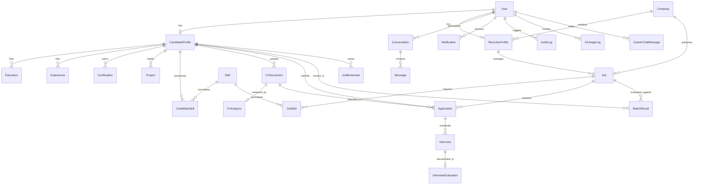

# TalentAI — Database Design

## 1. Overview

TalentAI uses a normalized **PostgreSQL 17** relational schema managed via **Prisma ORM** (`prisma/schema.prisma` and `prisma/migrations/20261120185142_init/migration.sql`). The schema comprises **26 models** and **14 enums**, enforcing referential integrity, cascading cleanup on user deletion, composite uniqueness constraints (such as preventing duplicate job applications), and indexed lookup columns.

---

## 2. Complete Entity Catalog (26 Models)

| # | Model | Primary Purpose | Key Relationships & Constraints |
|---|---|---|---|
| 1 | `User` | Core identity, credentials (`passwordHash`), `UserRole` (`CANDIDATE`, `RECRUITER`, `ADMIN`), `AccountStatus` (`ACTIVE`, `SUSPENDED`, `PENDING_VERIFICATION`), reset/verification tokens | `1:1` `CandidateProfile`, `1:1` `RecruiterProfile`; `@unique email`; indexed on `(role, status)` |
| 2 | `CandidateProfile` | Candidate headline, bio, location, years of experience, remote preference, career interests, dismissed recommendation IDs, recruiter searchability opt-in | Belongs to `User` (`onDelete: Cascade`); `1:N` Educations, Experiences, Skills, Certifications, Projects, CVs, Applications, Bookmarks |
| 3 | `RecruiterProfile` | Recruiter job title, department, bio, verification flag | Belongs to `User` and `Company` |
| 4 | `Company` | Hiring organization name, unique `slug`, website, description, industry, size, headquarters location, employer `verified` status | `1:N` `RecruiterProfile`, `1:N` `Job` |
| 5 | `Education` | Academic degrees, institution, field of study, dates, grade | Belongs to `CandidateProfile` (`Cascade`) |
| 6 | `Experience` | Work history entries, title, company, location, dates, current role flag, achievements | Belongs to `CandidateProfile` (`Cascade`) |
| 7 | `Skill` | Canonical normalized skill dictionary (`name`, `slug`, `SkillCategory`) | `1:N` `CandidateSkill`, `1:N` `JobSkill`; `@unique name`, `@unique slug` |
| 8 | `CandidateSkill` | Join entity linking candidate to skill with `SkillLevel` (`BEGINNER`..`EXPERT`), `yearsUsed`, and `verifiedByCV` | `@unique([candidateProfileId, skillId])` |
| 9 | `Certification` | Verified or candidate-entered professional credentials, issuer, dates, credential URL | Belongs to `CandidateProfile` (`Cascade`) |
| 10 | `Project` | Portfolio projects, summary, technologies array, repository/live links | Belongs to `CandidateProfile` (`Cascade`) |
| 11 | `CVDocument` | Metadata & extracted plain text of uploaded PDF/DOCX CVs, private `storagePath`, `isPrimary` flag | Belongs to `CandidateProfile`; `1:1` `CVAnalysis` |
| 12 | `CVAnalysis` | Structured AI CV extraction JSON, completeness score (0–100), strengths, missing info, improvement suggestions, `AIMode`, `reviewedByCandidate` | Linked `1:1` to `CVDocument` and `N:1` to `CandidateProfile` |
| 13 | `Job` | Job posting details, responsibilities, qualifications, benefits, experience/salary range, `WorkMode`, `EmploymentType`, `JobStatus` (`DRAFT`, `PUBLISHED`, `PAUSED`, `CLOSED`, `MODERATION_HOLD`), `aiGenerated`, `humanApproved`, `moderationNote` | Belongs to `Company` and `RecruiterProfile`; indexed on `(status, workMode, employmentType)` |
| 14 | `JobSkill` | Join entity linking `Job` to `Skill` (`isRequired`, `weight`) | `@unique([jobId, skillId])` |
| 15 | `Application` | Candidate job application, `ApplicationStatus` (9 lifecycle stages), cover letter, attached `cvDocumentId`, `aiMatchScore`, `recruiterPrivateNotes`, `candidateFeedback`, `rejectionReason`, JSON `statusHistory`, `hiredAt` | `@unique([jobId, candidateProfileId])` prevents duplicate applications |
| 16 | `MatchResult` | Explainable 0–100 compatibility breakdown (`skillScore`, `experienceScore`, `educationScore`, `responsibilityScore`, `languageScore`), `weightsUsed`, `matchingSkills`, `missingSkills`, `verificationAreas`, `recruiterOverrideScore`, `recruiterOverrideNote` | `@unique([jobId, candidateProfileId])` |
| 17 | `Interview` | Scheduled interview slot, `InterviewType`, `InterviewStatus`, duration, meeting link/location, instructions, custom/AI `generatedQuestions` JSON | Belongs to `Application`, `Job`, `CandidateProfile`, and `RecruiterProfile`; indexed on `(recruiterProfileId, scheduledAt)` for conflict detection |
| 18 | `InterviewEvaluation` | Consent-gated AI & human interview evaluation (`consentConfirmed`, `rawNotes`, `organizedSummary`, `evidenceMap`, `strengths`, `concerns`, `followUpQuestions`, `humanRecommendation`) | `1:1` with `Interview` |
| 19 | `Conversation` | Direct messaging thread between a Candidate User and Recruiter User (optionally scoped to a `Job`) | `@unique([candidateUserId, recruiterUserId, jobId])` |
| 20 | `Message` | Individual chat message inside a `Conversation` with read status | Belongs to `Conversation` and sender `User` |
| 21 | `Notification` | Real-time user alerts (`APPLICATION_RECEIVED`, `CANDIDATE_SHORTLISTED`, `INTERVIEW_SCHEDULED`, `MESSAGE_RECEIVED`, `SYSTEM`) | Indexed on `(userId, isRead, createdAt)` |
| 22 | `JobBookmark` | Candidate saved/bookmarked jobs | `@unique([candidateProfileId, jobId])` |
| 23 | `AuditLog` | Immutable security & governance trail (`actorId`, `actorRole`, `action`, `entityType`, `entityId`, `details`, `ipAddress`) | Indexed on `(action, createdAt)` and `actorId` |
| 24 | `AIUsageLog` | Telemetry for all 8 AI features (`feature`, `AIMode`, `modelName`, `latencyMs`, `tokensEstimated`, `status`, `errorMessage`) | Indexed on `(feature, mode, createdAt)` |
| 25 | `PlatformSetting` | Key-value JSON configuration store for Admin governance settings | `@unique key` |
| 26 | `CareerChatMessage` | Persistent message history for the Candidate AI Career Assistant | Belongs to `User` (`Cascade`) |

---

## 3. Entity Relationship Diagram (Mermaid)

---

## 4. Data Privacy & Integrity Rules

1. **Duplicate Application Prevention**: Enforced at both the application layer (`409 Conflict`) and PostgreSQL unique index `@@unique([jobId, candidateProfileId])`.
2. **Private Notes Confidentiality**: `Application.privateNotes` is stripped before serializing `GET /api/applications` responses for `CANDIDATE` users.
3. **Searchability Opt-In**: `CandidateProfile.isSearchableByRecruiters` controls whether a candidate appears in `/api/candidates` talent searches for companies they have not applied to.
4. **Cascading Account Deletion**: Deleting a `User` cleanly cascades to their profile, skills, bookmarks, and chat history without leaving orphaned records.
