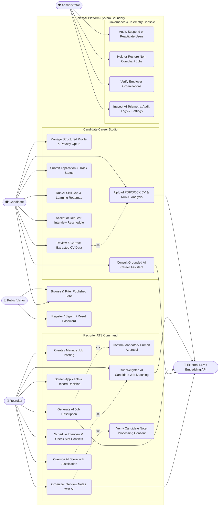
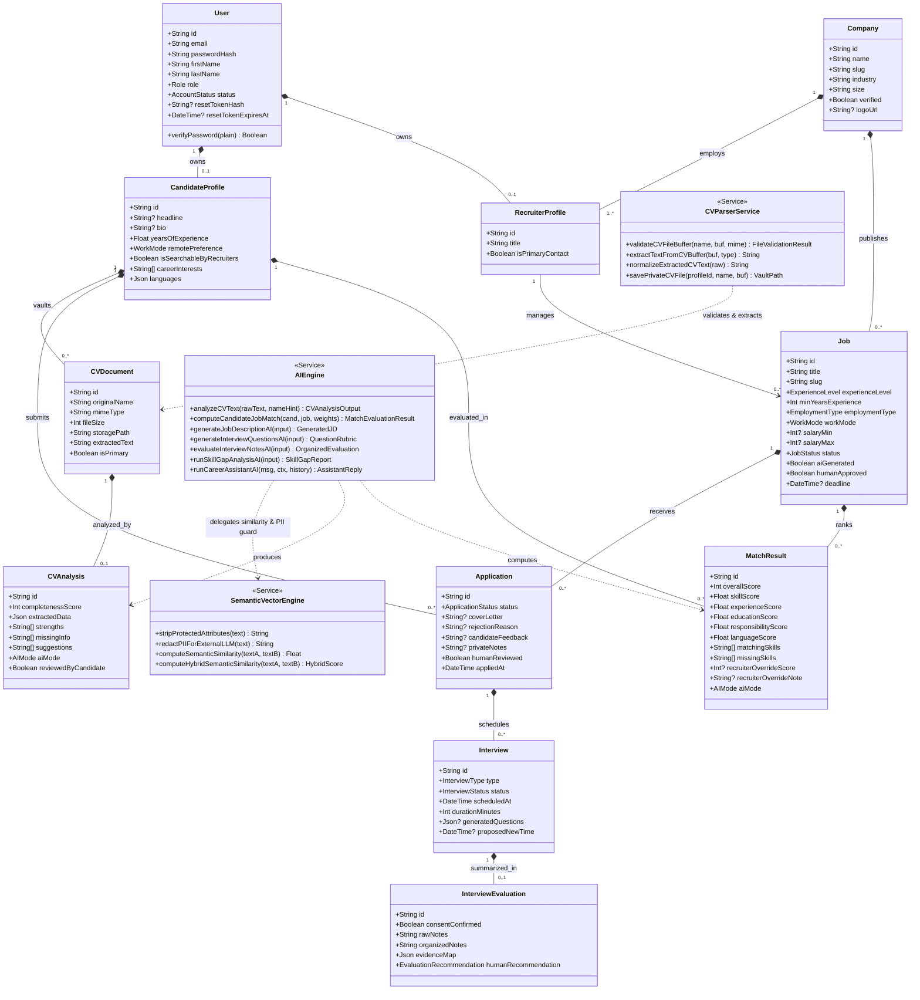
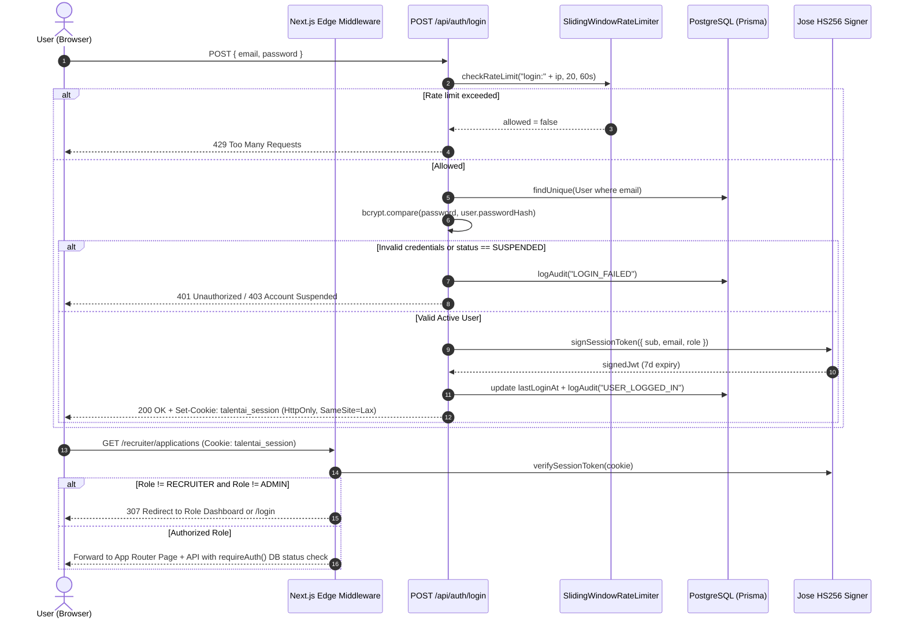
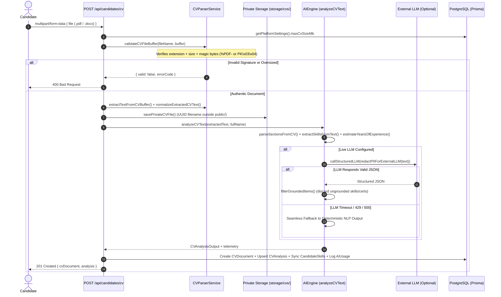
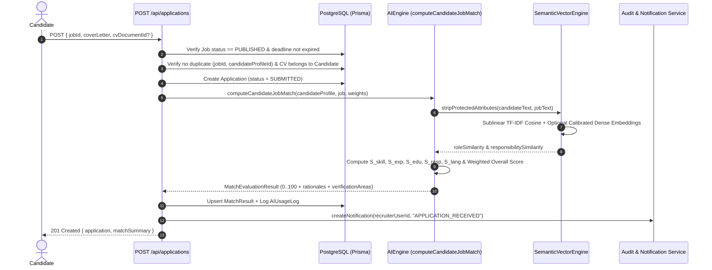
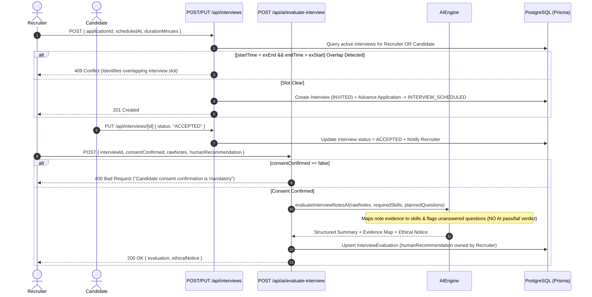
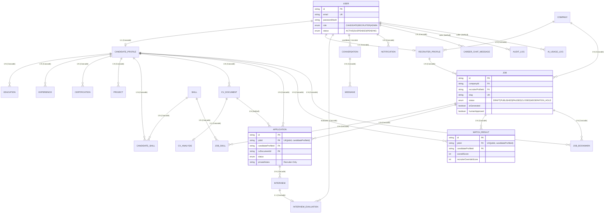
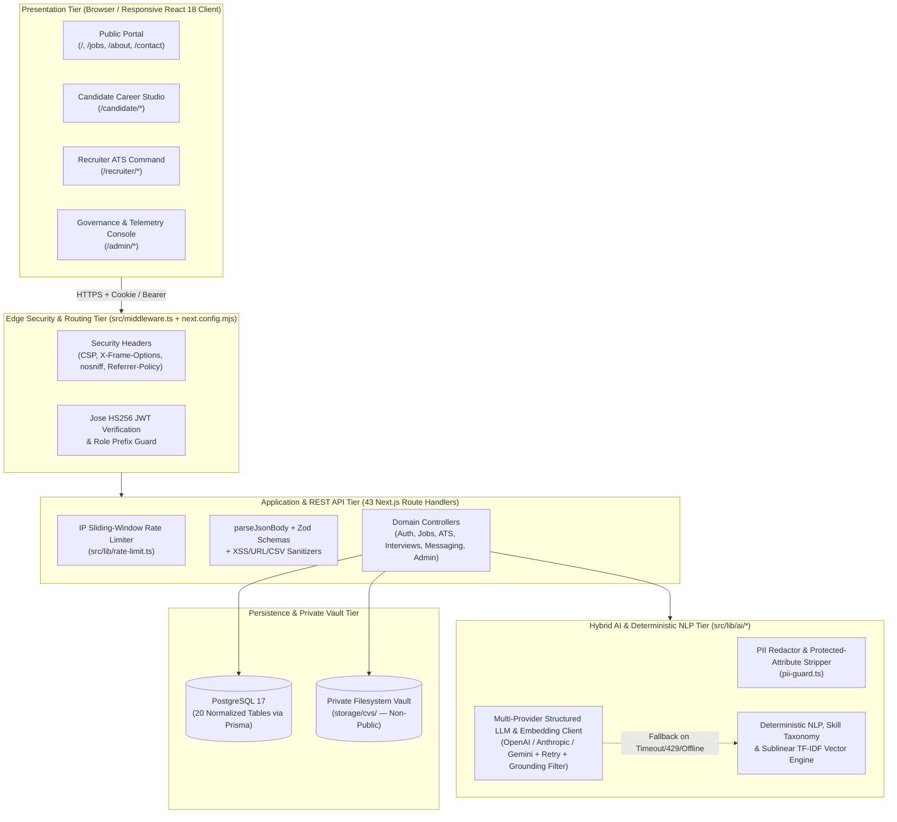
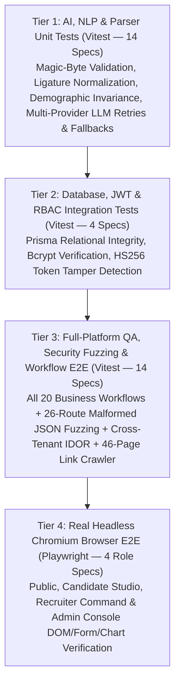

# TalentAI — Computer Science University Project Defense Documentation

**Project Title:** TalentAI: An Explainable, Privacy-Preserving, Hybrid AI Recruitment & Talent Management Platform  
**Repository (Single Source of Truth):** `https://github.com/houssem-thabet/ai-recruitment-platform`  
**Technology Stack:** Next.js 14 (App Router), TypeScript 5.6, PostgreSQL 17, Prisma ORM 5.22, Tailwind CSS, Zod, Jose (HS256 JWT), Hybrid AI Engine (OpenAI / Anthropic / Google Gemini + Deterministic NLP & Sublinear TF-IDF Vector Space Model), Vitest & Playwright  

---

## Table of Contents

1. [Project Objectives and Problem Statement](#1-project-objectives-and-problem-statement)
2. [Functional and Non-Functional Requirements](#2-functional-and-non-functional-requirements)
3. [UML Use-Case Diagram & Actor Specifications](#3-uml-use-case-diagram--actor-specifications)
4. [UML Class Diagram & Domain Model](#4-uml-class-diagram--domain-model)
5. [UML Sequence Diagrams (Core Execution Flows)](#5-uml-sequence-diagrams-core-execution-flows)
6. [Entity Relationship Diagram (ERD)](#6-entity-relationship-diagram-erd)
7. [System Architecture & Technical Design Decisions](#7-system-architecture--technical-design-decisions)
8. [Database Design, Normalization & Indexing](#8-database-design-normalization--indexing)
9. [REST API Architecture & Security Contracts](#9-rest-api-architecture--security-contracts)
10. [AI and Natural Language Processing (NLP) Algorithms](#10-ai-and-natural-language-processing-nlp-algorithms)
11. [Candidate–Job Matching Algorithm (Mathematical Specification)](#11-candidatejob-matching-algorithm-mathematical-specification)
12. [Security, Privacy & Responsible AI Governance](#12-security-privacy--responsible-ai-governance)
13. [Testing Methodology & Quality Assurance](#13-testing-methodology--quality-assurance)
14. [Experimental Results, Limitations & Future Work](#14-experimental-results-limitations--future-work)
15. [Oral Defense (Viva) Preparation: Key Jury Questions & Answers](#15-oral-defense-viva-preparation-key-jury-questions--answers)

---

## 1. Project Objectives and Problem Statement

### 1.1 Context and Problem Statement
Modern digital recruitment suffers from three structural engineering failures:

1. **Opaque Keyword Filtering ("Black-Box ATS"):** Legacy Applicant Tracking Systems rely on brittle exact-string matching. A candidate who lists `React.js` or `PostgreSQL` can fail a filter expecting `React` or `Postgres`, and candidates never learn *why* they scored poorly or which skills they lack.
2. **Unreliable & Biased Generative AI Wrappers:** Naive LLM-based recruitment prototypes suffer from three critical defects:
   - **Hallucination:** Inventing skills, degrees, or employers not present in the candidate's CV.
   - **Demographic Bias & PII Leakage:** Allowing protected attributes (gender, age, nationality, marital status, religion) to influence rankings, and transmitting raw personal identifiers (emails, phone numbers, IDs) to third-party APIs.
   - **Single-Point Availability Failure:** Crashing completely when external LLM APIs hit rate limits (`HTTP 429`), network timeouts, or missing API keys in offline academic grading environments.
3. **Weak Tenant & Document Privacy Isolation:** Many student and startup platforms store uploaded CVs in public static folders (`public/uploads`) or expose cross-company candidate pipelines via Insecure Direct Object References (IDOR).

### 1.2 Core Project Objectives
TalentAI was engineered to solve these problems through five verifiable Computer Science objectives:

| Objective ID | Engineering Objective | Concrete Realization in TalentAI |
| :--- | :--- | :--- |
| **OBJ-1** | **End-to-End Multi-Role ATS & Career Studio** | Unified platform serving three strictly isolated roles: **Candidate** (*Career Studio*), **Recruiter** (*ATS Command*), and **Administrator** (*Governance & Telemetry Console*). |
| **OBJ-2** | **Hybrid Resilient AI Architecture** | Dual-mode AI engine supporting live structured LLM + dense embeddings (**OpenAI**, **Anthropic Claude**, **Google Gemini**) backed by a **100% deterministic local NLP & Sublinear TF-IDF Vector Engine** with automatic zero-downtime fallback. |
| **OBJ-3** | **Explainable & Auditable Decision Support** | Every 0–100 compatibility score is decomposed into 5 weighted dimensions (*Skills, Experience, Education, Responsibilities, Language*) with human-readable rationales, verification prompts, and **Recruiter Score Override**—never auto-rejecting candidates. |
| **OBJ-4** | **Mathematically Fair & Anti-Hallucination NLP** | Pre-vectorization demographic stripping (`stripProtectedAttributes`), PII redaction before external API calls (`redactPIIForExternalLLM`), and grounding verification (`filterGroundedItems`) that discards any LLM-claimed skill not evidenced in the source CV. |
| **OBJ-5** | **Defense-in-Depth Security & Privacy** | Private filesystem CV vault (`storage/cvs/`), magic-byte binary verification (`%PDF-` / `PK\x03\x04`), HS256 Edge JWT + RBAC middleware, cross-tenant IDOR guards, CSV formula neutralization (`CWE-1236`), and GDPR account erasure. |

---

## 2. Functional and Non-Functional Requirements

### 2.1 Functional Requirements (FR)

#### A. Candidate Module (*Candidate Career Studio*)
| ID | Requirement | Endpoint / Route | Priority |
| :--- | :--- | :--- | :--- |
| **FR-CAND-01** | Register, authenticate, reset password via time-limited SHA-256 token, and manage account settings or permanent GDPR account deletion. | `/register`, `/login`, `/forgot-password`, `/api/auth/*` | Must |
| **FR-CAND-02** | Build a structured professional profile (bio, experience, education, skills with proficiency levels, certifications, projects, languages, salary & remote preferences, and recruiter searchability opt-in/out). | `GET/PUT /api/candidates/profile` | Must |
| **FR-CAND-03** | Upload PDF/DOCX CVs validated by binary magic bytes; automatically extract normalized text and run AI CV completeness & section extraction. | `POST /api/candidates/cv` | Must |
| **FR-CAND-04** | Inspect and **manually correct/verify** AI-extracted CV fields (*Human-in-the-Loop Feature 1*). | `PUT /api/candidates/cv/[id]` | Must |
| **FR-CAND-05** | Search, filter, sort, and paginate published jobs; bookmark/unbookmark jobs; inspect live AI compatibility preview on any job detail page. | `GET /api/jobs`, `POST /api/candidates/bookmarks` | Must |
| **FR-CAND-06** | Receive personalized AI job recommendations with transparent *"Why Recommended"* badges and dismiss/restore controls. | `GET/POST /api/ai/recommendations` | Must |
| **FR-CAND-07** | Submit job applications with optional cover letter and owned CV attachment; track pipeline status, read constructive recruiter feedback, or withdraw applications. | `POST /api/applications`, `PUT /api/applications/[id]/status` | Must |
| **FR-CAND-08** | Accept interview invitations or propose rescheduled dates with explanatory notes. | `PUT /api/interviews/[id]` | Must |
| **FR-CAND-09** | Run **AI Skill Gap Analysis** against career path blueprints or live jobs, producing calibrated proficiency charts and prerequisite-ordered project roadmaps. | `GET/POST /api/ai/skill-gap` | Must |
| **FR-CAND-10** | Converse with the multi-turn **AI Career Assistant** grounded strictly on the candidate's verified profile, CV audit, and live platform jobs. | `GET/POST/DELETE /api/ai/career-assistant` | Must |

#### B. Recruiter Module (*Recruiter ATS Command*)
| ID | Requirement | Endpoint / Route | Priority |
| :--- | :--- | :--- | :--- |
| **FR-REC-01** | Register company & recruiter workspace; manage public employer brand, industry, website, and validated raster logo. | `GET/PUT /api/recruiter/company` | Must |
| **FR-REC-02** | Create, edit, pause, close, and delete job postings with structured skills, responsibilities, qualifications, compensation range, and deadlines. | `GET/POST /api/jobs`, `PUT/DELETE /api/jobs/[id]` | Must |
| **FR-REC-03** | Generate structured, bias-audited job descriptions using AI, gated by **mandatory Human Approval** before publication (*Human-in-the-Loop Feature 3*). | `POST /api/ai/generate-job-description` | Must |
| **FR-REC-04** | Manage applicants in interactive **Kanban** and **Table** pipelines; enforce documented constructive reasons when rejecting candidates; record private internal notes isolated from candidates. | `/recruiter/applications`, `PUT /api/applications/[id]/status` | Must |
| **FR-REC-05** | Download applicant CVs strictly when the candidate has applied to the recruiter's company. | `GET /api/candidates/cv/[id]?download=1` | Must |
| **FR-REC-06** | Run **AI Candidate–Job Matching** with customizable dimension weights $(w_{\text{skill}}, w_{\text{exp}}, w_{\text{edu}}, w_{\text{resp}}, w_{\text{lang}})$ across job applicants or opted-in talent pool. | `GET/POST /api/ai/match-candidate` | Must |
| **FR-REC-07** | Review and **manually override AI match scores** with documented justification (*Human-in-the-Loop Feature 2*). | `PUT /api/ai/match-candidate` | Must |
| **FR-REC-08** | Search the opted-in candidate database by keyword, skill, location, minimum experience, education, and language. | `GET /api/candidates` | Must |
| **FR-REC-09** | Schedule interviews with automatic **time-slot overlap conflict detection (`HTTP 409`)** across both recruiter and candidate calendars. | `POST /api/interviews`, `PUT /api/interviews/[id]` | Must |
| **FR-REC-10** | Generate role-specific **AI Interview Question Rubrics** and run **Consent-Gated AI Interview Note Organization** mapping raw notes to competency evidence without pass/fail verdicts. | `POST /api/ai/generate-interview-questions`, `POST /api/ai/evaluate-interview` | Must |
| **FR-REC-11** | Exchange direct encrypted-thread messages with candidates and export formula-safe CSV analytics reports. | `GET/POST /api/messages`, `GET /api/recruiter/analytics` | Should |

#### C. Administrator Module (*Governance & Telemetry Console*)
| ID | Requirement | Endpoint / Route | Priority |
| :--- | :--- | :--- | :--- |
| **FR-ADM-01** | Monitor platform-wide KPIs, 6-month registration/job/application/hire trends, funnel conversions, and AI feature call telemetry. | `GET /api/admin/dashboard`, `GET /api/admin/ai-logs` | Must |
| **FR-ADM-02** | Audit, suspend, or reactivate user accounts (preventing self-suspension) while preserving strict CV confidentiality (admins cannot browse private CV files). | `GET /api/admin/users`, `PUT /api/admin/users/[id]/status` | Must |
| **FR-ADM-03** | Verify or revoke employer verification badges across registered companies. | `GET/PUT /api/admin/companies` | Must |
| **FR-ADM-04** | Place non-compliant job postings on **`MODERATION_HOLD`** (locked against recruiter self-restoration) or restore compliant jobs with audit notifications. | `GET/PUT /api/admin/jobs` | Must |
| **FR-ADM-05** | Configure live platform governance parameters (`maxCvSizeMb`, `dataRetentionDays`, `requireHumanApprovalForAIJobs`, public registration switches) and inspect immutable `AuditLog` trails. | `GET/PUT /api/admin/settings`, `GET /api/admin/audit-logs` | Must |

### 2.2 Non-Functional Requirements (NFR)

| Category | Requirement Specification | Target Metric / Verification |
| :--- | :--- | :--- |
| **NFR-SEC (Security)** | Passwords hashed with `bcryptjs` (cost factor 10); HS256 JWTs verified at Edge; zero cross-tenant IDORs; magic-byte upload checks; XSS/URI/CSV-injection sanitization; sliding-window IP rate limiting. | `0` IDOR leaks; `400` on malformed JSON across 26 write routes; `429` on brute-force bursts. |
| **NFR-PRIV (Privacy)** | Uploaded CVs stored outside `public/`; accessible only to owning candidate and recruiters of applied companies; PII redacted prior to external LLM calls; GDPR erasure cascades cleanly. | Verified by integration & QA test suites (`403` on unauthorized recruiter/admin CV fetch). |
| **NFR-REL (Resilience)** | Every AI endpoint must remain 100% operational without external API keys or during external LLM outages (`HTTP 429`/`500`/timeout) via deterministic NLP fallback. | `100%` uptime in offline mode; exponential backoff retry + Zod schema validation on LLM JSON. |
| **NFR-FAIR (Fairness)** | Matching scores must be mathematically invariant to protected demographic terms (gender, age, race, religion, marital status, disability, nationality). | Verified by counterfactual demographic invariance unit tests (`score(A) === score(B)`). |
| **NFR-PERF (Performance)** | Deterministic NLP CV parsing and candidate-job matching execute in $< 50\text{ ms}$; paginated SQL queries backed by composite B-Tree indexes. | Vitest suite (`32` tests) completes in `< 10s`; deterministic match latency `2–18 ms`. |
| **NFR-MAINT (Maintainability)** | End-to-end strict TypeScript (`strict: true`), declarative Prisma schema, shared Zod validators, and automated Vitest + Playwright CI suites. | `npx tsc --noEmit` (`0` errors); `83/83` Next.js production routes built cleanly. |

---

## 3. UML Use-Case Diagram & Actor Specifications

### 3.1 Primary & Secondary Actors
1. **Public Visitor:** Unauthenticated user browsing landing pages, live platform statistics, and public published job listings.
2. **Candidate:** Job seeker managing their profile, private CV vault, job applications, interviews, skill roadmaps, and AI career coaching.
3. **Recruiter:** Employer representative managing company branding, job postings, applicant pipelines, interviews, and AI candidate rankings.
4. **Administrator:** Platform governance officer managing account status, employer verification, job moderation holds, AI telemetry, audit trails, and global policies.
5. **External LLM / Embedding Provider *(Secondary System Actor)*:** Optional cloud inference API (OpenAI / Anthropic / Gemini) invoked through PII-redacting adapters when configured.

### 3.2 UML Use-Case Diagram (Mermaid)

> **Key Defense Insight on `<<include>>` vs. `<<extend>>`:**  
> - **Mandatory Responsible AI Guardrails (`<<include>>`):** Publishing an AI-generated job description *always includes* `Confirm Mandatory Human Approval`, and organizing interview notes with AI *always includes* `Verify Candidate Consent` (`HTTP 400` if unchecked).  
> - **Optional Human-in-the-Loop Overrides (`<<extend>>`):** `Override AI Score` *extends* `Run Weighted AI Matching` when a recruiter's domain judgment differs from the mathematical score, preserving human authority over hiring decisions.

---

## 4. UML Class Diagram & Domain Model

The UML Class Diagram below captures both the **persistent domain entities** (`User`, `CandidateProfile`, `RecruiterProfile`, `Company`, `Job`, `Application`, `CVDocument`, `CVAnalysis`, `MatchResult`, `Interview`, `InterviewEvaluation`, `Conversation`, `Message`) and the **core service/algorithmic classes** (`CVParserService`, `AIEngine`, `SemanticVectorEngine`, `SkillTaxonomyService`, `PIIGuard`, `SecurityService`).

---

## 5. UML Sequence Diagrams (Core Execution Flows)

### 5.1 Sequence 1: Authentication, JWT Issuance & Edge RBAC Enforcement

### 5.2 Sequence 2: Private CV Upload, Magic-Byte Validation & Anti-Hallucination AI Parsing

### 5.3 Sequence 3: Job Application & 5-Dimension Explainable Matching Pipeline

### 5.4 Sequence 4: Interview Conflict Detection & Consent-Gated Note Evaluation

---

## 6. Entity Relationship Diagram (ERD)

TalentAI's PostgreSQL 17 schema comprises **20 relational tables** and **13 strongly-typed enums** managed via Prisma ORM.

---

## 7. System Architecture & Technical Design Decisions

### 7.1 Layered Modular Monolith Architecture

### 7.2 Defense of Key Architectural Decisions (ADRs)

1. **Why a Next.js 14 Modular Monolith in TypeScript instead of Microservices?**
   - **Shared End-to-End Type Safety:** Prisma-generated types, Zod validation schemas, and AI interfaces are shared directly between backend Route Handlers and React UI components with zero schema drift.
   - **Operational Simplicity & Zero Network Serialization Overhead:** A modular monolith avoids distributed transaction complexity (2PC/Saga) while keeping clean module boundaries (`src/lib/ai`, `src/lib/auth`, `src/app/api/*`) that can be extracted into standalone worker services if traffic scales past $10^5$ concurrent users.
2. **Why PostgreSQL 17 + Prisma instead of a NoSQL Document Store (MongoDB)?**
   - Recruitment workflows are inherently relational and transactional: an `Application` links a `CandidateProfile`, a `Job`, a `Company`, a `CVDocument`, a `MatchResult`, and multiple `Interview` records. PostgreSQL enforces **ACID transactions**, **composite unique constraints** (preventing duplicate applications at the database kernel level), and **referential `ON DELETE CASCADE` / `SET NULL` rules** while still supporting `JSONB` for flexible AI metadata (`extractedData`, `evidenceMap`).
3. **Why `jose` (HS256) + Dual Cookie/Bearer Session Strategy?**
   - Next.js Edge Middleware runs in the lightweight V8 Edge Runtime where Node native C++ addons are unavailable; `jose` implements WebCrypto-standards-compliant HS256 JWT signing/verification in `< 1 ms`. Supporting `HttpOnly` cookies *plus* `Authorization: Bearer` fallback ensures seamless operation in both standalone browsers and cross-origin sandboxed preview iframes.
4. **Why a Hybrid AI Architecture instead of Pure LLM Calls?**
   - Pure LLM calls are non-deterministic, vulnerable to API outages, expensive at batch-ranking scale, and prone to hallucination. TalentAI computes a deterministic mathematical baseline first, optionally enriches qualitative prose via structured LLM calls (validated by Zod + `filterGroundedItems`), and falls back transparently in `0 ms` if no API key is configured.

---

## 8. Database Design, Normalization & Indexing

### 8.1 Third Normal Form (3NF) & Controlled JSONB Usage
- **1NF & 2NF Compliance:** Repeating skill lists on candidates and jobs are decomposed into canonical many-to-many join entities (`Skill` $\leftrightarrow$ `CandidateSkill` and `Skill` $\leftrightarrow$ `JobSkill`) keyed by composite unique constraints `@@unique([candidateProfileId, skillId])` and `@@unique([jobId, skillId])`.
- **3NF Compliance:** Company attributes (`name`, `industry`, `size`, `verified`, `logoUrl`) live exclusively on `Company` rather than being duplicated across `Job` or `RecruiterProfile` rows; transitive dependencies are eliminated.
- **Controlled `JSONB` Columns:** Used intentionally only for immutable/versioned audit snapshots where schema flexibility is advantageous:
  - `CVAnalysis.extractedData` (structured CV snapshot editable by candidate),
  - `MatchResult.weightsUsed` (exact weight vector used at scoring time for auditability),
  - `Application.statusHistory` (chronological state-transition log),
  - `InterviewEvaluation.evidenceMap` (competency-to-note mappings).

### 8.2 Referential Integrity (`onDelete` Rules)
- **`onDelete: Cascade`:** Deleting a `User` (`DELETE /api/auth/me`) automatically cascades through `CandidateProfile`, `Education`, `Experience`, `CandidateSkill`, `CVDocument`, `CVAnalysis`, `Application`, `MatchResult`, `JobBookmark`, `Conversation`, `Message`, `Notification`, and `CareerChatMessage`, guaranteeing **complete GDPR Right-to-Erasure** without orphan records.
- **`onDelete: SetNull`:** Deleting a `User` sets `actorId = NULL` on `AuditLog` and `userId = NULL` on `AIUsageLog` so **historical security audit trails and telemetry aggregates remain intact** even after account deletion. Similarly, deleting a `CVDocument` sets `Application.cvDocumentId = NULL` without destroying the recruiter's historical application record.

### 8.3 B-Tree Indexing Strategy
Key high-cardinality query paths are accelerated by explicit indexes in `prisma/schema.prisma`:
- `Job`: `@@index([status, publishedAt])`, `@@index([companyId])`, `@@index([experienceLevel, employmentType, workMode])`
- `MatchResult`: `@@unique([jobId, candidateProfileId])`, `@@index([jobId, overallScore])` (enables $O(\log N)$ sorted leaderboard retrieval)
- `Interview`: `@@index([candidateProfileId, scheduledAt])`, `@@index([recruiterProfileId, scheduledAt])` (accelerates slot-conflict detection)
- `Notification` & `AuditLog`: `@@index([userId, isRead, createdAt])`, `@@index([action, createdAt])`

---

## 9. REST API Architecture & Security Contracts

TalentAI exposes **43 RESTful Route Handlers** grouped into **11 bounded resource namespaces**:

| Namespace | Endpoints Count | Key Routes & Methods | Allowed Roles |
| :--- | :---: | :--- | :--- |
| **`/api/auth/*`** | 6 | `POST login`, `POST register`, `POST logout`, `GET/PUT/DELETE me`, `POST forgot-password`, `POST reset-password` | Public / Authenticated |
| **`/api/jobs/*`** | 2 | `GET/POST /api/jobs`, `GET/PUT/DELETE /api/jobs/[id]` | Public (`GET`), `RECRUITER`, `ADMIN` |
| **`/api/candidates/*`** | 7 | `GET /api/candidates`, `GET /[id]`, `GET/PUT /profile`, `GET/POST /cv`, `GET/PUT/DELETE /cv/[id]`, `GET /applications`, `GET/POST /bookmarks`, `GET /dashboard` | `CANDIDATE`, `RECRUITER` (scoped), `ADMIN` |
| **`/api/applications/*`** | 2 | `GET/POST /api/applications` (`?format=csv`), `PUT /api/applications/[id]/status` | `CANDIDATE`, `RECRUITER`, `ADMIN` |
| **`/api/interviews/*`** | 2 | `GET/POST /api/interviews`, `PUT /api/interviews/[id]` | `CANDIDATE`, `RECRUITER`, `ADMIN` (`GET`) |
| **`/api/messages`** | 1 | `GET/POST /api/messages` | `CANDIDATE` $\leftrightarrow$ `RECRUITER` |
| **`/api/notifications`** | 1 | `GET/PUT /api/notifications` | Authenticated |
| **`/api/recruiter/*`** | 3 | `GET /dashboard`, `GET/PUT /company`, `GET /analytics` (`?format=csv`) | `RECRUITER`, `ADMIN` (`analytics`) |
| **`/api/admin/*`** | 9 | `GET /dashboard`, `GET /users`, `PUT /users/[id]/status`, `GET/PUT /companies`, `GET/PUT /jobs`, `GET /analytics`, `GET /ai-logs`, `GET /audit-logs`, `GET/PUT /settings` | `ADMIN` only |
| **`/api/public/*`** | 2 | `GET /stats`, `POST /contact` | Public |
| **`/api/ai/*`** | 8 | `analyze-cv`, `match-candidate` (`GET/POST/PUT`), `generate-job-description`, `generate-interview-questions`, `evaluate-interview`, `career-assistant` (`GET/POST/DELETE`), `skill-gap` (`GET/POST`), `recommendations` (`GET/POST`) | Role-scoped (`CANDIDATE` / `RECRUITER` / `ADMIN`) |

### Uniform API Request Pipeline
Every incoming API request passes through five deterministic layers:
1. **Rate-Limit Guard (`checkRateLimit`):** Sliding-window counter per client IP / user ID (`HTTP 429` with `resetInSeconds` on burst abuse).
2. **Authentication & Active-Account Verification (`requireAuth`):** Verifies JWT signature *and* queries PostgreSQL to ensure `user.status === 'ACTIVE'` (so an admin suspension takes effect **immediately** even before token expiry).
3. **Safe JSON Deserialization (`parseJsonBody`):** Catches malformed/empty JSON bodies and returns `400 Bad Request` instead of unhandled `SyntaxError` `500`s.
4. **Declarative Schema & Enum Validation (`Zod` + Enum Sets):** Validates string bounds, date validity (`1900..2100`), salary ordering (`salaryMax >= salaryMin`), and Prisma enum membership.
5. **Tenant Ownership Check & Sanitization:** Verifies `job.companyId === auth.user.companyId` or `cv.candidateProfileId === auth.user.candidateProfileId` (`403 Forbidden`), sanitizes outputs, and logs `AuditLog` / `AIUsageLog`.

---

## 10. AI and Natural Language Processing (NLP) Algorithms

TalentAI implements **8 distinct AI/NLP subsystems** inside `src/lib/ai/`:

### 10.1 Binary Document Parsing & Typographic Normalization (`src/lib/cv-parser.ts`)
1. **Magic-Byte Signature Verification:** Rejects spoofed file extensions before parsing by checking raw byte headers: `0x25 0x50 0x44 0x46 0x2D` (`%PDF-`) for PDFs and `0x50 0x4B 0x03 0x04` (`PK\x03\x04`) for OOXML `.docx` archives.
2. **Artifact Cleaning (`normalizeExtractedCVText`):** Expands Unicode typographic ligatures (`fi` $\to$ `fi`, `fl` $\to$ `fl`, `ff` $\to$ `ff`), strips zero-width/soft-hyphen characters (`U+00AD`, `U+200B`), rejoins hyphenated line wraps, collapses multi-column whitespace gaps, and strips `Page X of Y` footers.

### 10.2 Finite-State CV Section Segmentation & Interval-Union Experience Estimator (`src/lib/ai/engine.ts`)
- **Section Segmentation (`parseSectionsFromCV`):** Scans normalized lines using bilingual (English/French) heading regular expressions (`Experience`, `Expériences Professionnelles`, `Education`, `Formation`, `Skills`, `Compétences`, `Projects`, `Certifications`, `Languages`) to partition raw prose into 9 semantic buckets.
- **Non-Overlapping Experience Calculation (`estimateYearsOfExperience`):**  
  Naive parsers sum the duration of every job listed on a CV, **double-counting** concurrent part-time/freelance roles! TalentAI converts every parsed date span $[m_{\text{start}}, m_{\text{end}}]$ into integer month indices ($12 \times \text{year} + \text{month}$), sorts intervals in $O(K \log K)$ time, and computes the **measure of their set union**:
  $$\text{Months}_{\text{total}} = \left| \bigcup_{i=1}^{K} [s_i, e_i] \right|, \qquad Y_{\text{exp}} = \text{ clamp}_{[0, 40]}\!\left(\text{round}\!\left(\frac{\text{Months}_{\text{total}}}{12}\right)\right)$$

### 10.3 Canonical Skill Taxonomy & Anti-Hallucination Grounding (`skill-taxonomy.ts` & `engine.ts`)
- **Alias Normalization Graph:** Maps `50+` core engineering, data, cloud, and soft skills across surface aliases (`reactjs` / `react 18` $\to$ `React`, `k8s` $\to$ `Kubernetes`, `postgres` $\to$ `PostgreSQL`) using boundary-aware regular expressions that preserve punctuation tokens such as `C++`, `C#`, `.NET`, and `Node.js`.
- **Anti-Hallucination Verifier (`filterGroundedItems`):** Whenever an external LLM extracts skills or certifications, every returned item $x$ is cross-checked against both the deterministic taxonomy whitelist $W_{\text{det}}$ and the lowercase raw CV text $T_{\text{raw}}$:
  $$\text{Accepted}(x) \iff \big(\text{canon}(x) \in W_{\text{det}}\big) \lor \big(\text{lower}(x) \subseteq T_{\text{raw}}\big)$$
  Any ungrounded item fabricated by an LLM is deterministically discarded before saving.

### 10.4 Sublinear TF-IDF Vector Space Model & Calibrated Hybrid Embeddings (`semantic.ts`)
1. **Demographic Scrubbing & Stemming:** Both texts pass through `stripProtectedAttributes`, stopword removal, synonym canonicalization (`microservices` $\to$ `distributed`, `rbac` $\to$ `auth`), and suffix stemming.
2. **Feature Space Construction:** Constructs unigrams ($t_i$), contiguous phrase bigrams ($\text{bi}:t_i\_t_{i+1}$), and canonical skill concept tokens ($\text{skill}:s$).
3. **Sublinear TF-IDF Weighting:** Prevents keyword-stuffing attacks (repeating `"Python"` 50 times in white font on a CV) by applying logarithmic term-frequency dampening:
   $$w(f, d) = \big(1 + \ln(\text{count}(f, d))\big) \times \text{idf}(f), \quad \text{idf}(f) = \begin{cases} 2.10 & \text{if } f \text{ is a canonical skill token} \\ 1.65 & \text{if } f \in \text{HIGH\_SIGNAL\_STEMS} \\ 1.35 & \text{if } f \text{ is a phrase bigram} \\ 1.00 & \text{otherwise} \end{cases}$$
4. **Cosine Similarity & Hybrid Dense Embedding Calibration:**
   $$s_{\text{lexical}}(A, B) = \frac{\sum_{f} w(f, A)\, w(f, B)}{\sqrt{\sum_f w(f, A)^2}\;\sqrt{\sum_f w(f, B)^2}} \in [0, 1]$$
   When live dense embeddings (`text-embedding-3-small` or `text-embedding-004`) are enabled, TalentAI corrects for embedding-space anisotropy (where unrelated English texts have raw cosine $\approx 0.18\text{–}0.25$) via linear calibration before convex fusion:
   $$s_{\text{dense,cal}} = \text{clamp}_{[0, 1]}\!\left(\frac{\cos(\mathbf{v}_A, \mathbf{v}_B) - 0.18}{0.70}\right), \qquad s_{\text{hybrid}} = 0.68\, s_{\text{dense,cal}} + 0.32\, s_{\text{lexical}}$$

### 10.5 Prerequisite Topological Ordering for Skill Gap Roadmaps
Missing target skills are ordered via topological foundation ranks (`SKILL_FOUNDATION_RANK` $\in \{1..5\}$: e.g., `JavaScript (1)` $\to$ `TypeScript (2)` $\to$ `React (3)` $\to$ `Next.js (4)` $\to$ `System Design / Kubernetes (5)`), pairing each missing skill with an estimated week budget and a concrete portfolio project blueprint.

---

## 11. Candidate–Job Matching Algorithm (Mathematical Specification)

### 11.1 Five-Dimension Scoring Equations
Given a candidate profile $C$, a job specification $J$, and raw recruiter weights $W = (w_1, w_2, w_3, w_4, w_5)$ (defaulting to $(40, 25, 15, 15, 5)$), weights are first normalized onto the 100-simplex:
$$\hat{w}_k = \frac{\max(0, w_k)}{\sum_{j=1}^{5} \max(0, w_j)} \times 100$$

1. **Dimension 1 — Technical & Transferable Ecosystem Skills ($S_{\text{skill}} \in [0, 100]$, default $\hat{w}_1 = 40\%$):**  
   For each required canonical job skill $r \in R_J$, `computeSkillTransferability` assigns credit $c(r, C)$:
   $$c(r, C) = \begin{cases} 1.00 & \text{if } r \in S_C \text{ (Exact Match)} \\ \alpha_{r, s} \in [0.35, 0.85] & \text{if } \exists s \in S_C \text{ in } \text{TransferabilityMap}(r) \text{ (e.g., Vue.js} \to \text{React: } 0.60\text{)} \\ 0.00 & \text{otherwise} \end{cases}$$
   With optional preferred/soft skill bonus $E_J$:
   $$S_{\text{skill}} = \text{round}\!\left(\min\!\left(100,\; \frac{\sum_{r \in R_J} c(r, C)}{|R_J|} \times 100 + 10 \cdot \frac{|E_J \cap S_C|}{\max(1, |E_J|)}\right)\right)$$

2. **Dimension 2 — Relevant Experience & Role Alignment ($S_{\text{exp}} \in [0, 100]$, default $\hat{w}_2 = 25\%$):**  
   Blends quantitative years-of-experience sufficiency ($68\%$) with semantic role-history similarity ($32\%$):
   $$r_{\text{years}} = \begin{cases} 1 & \text{if } y_{\text{req}} = 0 \\ \min(1,\; y_{\text{cand}} / y_{\text{req}}) & \text{if } y_{\text{req}} > 0 \end{cases}, \qquad S_{\text{exp}} = \text{round}\!\Big(\text{clamp}_{[0,100]}\big(68 \cdot r_{\text{years}} + 32 \cdot \min(1,\; 2.2 \cdot s_{\text{hybrid}}(\text{Exp}_C, \text{Role}_J))\big)\Big)$$

3. **Dimension 3 — Education & Certifications ($S_{\text{edu}} \in [0, 100]$, default $\hat{w}_3 = 15\%$):**  
   Maps degrees to ordinal academic ranks $\rho \in \{0:\text{None},\; 1:\text{Diploma},\; 2:\text{Bachelor},\; 3:\text{Master/Ingénieur},\; 4:\text{PhD}\}$:
   - Base score: $95$ if $\rho_C \ge \max(\rho_J, 3)$; $90$ if $\rho_C \ge \rho_J$; $78$ if $\rho_C = \rho_J - 1$ (one tier below); $68$ if $\rho_C < \rho_J - 1$; $75$ if no degree is required by the job.
   - Certification bonus: $+\min(10,\; 5 \times |N_{\text{cert}}|)$, capped at $100$.

4. **Dimension 4 — Responsibilities & Project Semantic Relevance ($S_{\text{resp}} \in [20, 100]$, default $\hat{w}_4 = 15\%$):**  
   Evaluates semantic cosine alignment between the candidate's combined project/experience/CV corpus and the job's responsibilities & qualifications:
   $$S_{\text{resp}} = \text{round}\!\Big(\text{clamp}_{[20, 100]}\big(205 \cdot s_{\text{hybrid}}(\text{Corpus}_C, \text{Resp}_J)\big)\Big)$$

5. **Dimension 5 — Spoken Language Coverage ($S_{\text{lang}} \in [0, 100]$, default $\hat{w}_5 = 5\%$):**
   $$S_{\text{lang}} = \begin{cases} \text{round}\!\left(100 \times \frac{|L_C \cap L_J|}{|L_J|}\right) & \text{if } |L_C| > 0 \\ 70 & \text{if } L_C = \emptyset \text{ (flagged in } \text{verificationAreas}\text{)} \end{cases}$$

6. **Composite Compatibility Score:**
   $$S_{\text{overall}} = \text{round}\!\left(\frac{S_{\text{skill}}\hat{w}_1 + S_{\text{exp}}\hat{w}_2 + S_{\text{edu}}\hat{w}_3 + S_{\text{resp}}\hat{w}_4 + S_{\text{lang}}\hat{w}_5}{100}\right) \in [0, 100]$$

### 11.2 Worked Numerical Example (For Jury Presentation)
Suppose Candidate **Yasmine** applies for **Senior Full-Stack Engineer**:
- **Job Requirements:** `TypeScript`, `React`, `Next.js`, `PostgreSQL`, `Kubernetes` ($|R_J|=5$), $y_{\text{req}} = 4\text{ yrs}$, Master's preferred ($\rho_J=3$), languages `English, French`.
- **Candidate Evidence:** Has `TypeScript (1.0)`, `React (1.0)`, `Next.js (1.0)`, `PostgreSQL (1.0)`, and `Docker` (adjacent to `Kubernetes` with transfer credit $0.55$) $\implies \sum c = 4.55 \implies S_{\text{skill}} = \text{round}(\frac{4.55}{5}\times 100) = \mathbf{91}$.
- **Experience:** $y_{\text{cand}} = 4\text{ yrs}$ ($r_{\text{years}}=1.0$) and $s_{\text{hybrid}} = 0.38 \implies S_{\text{exp}} = \text{round}(68(1) + 32(0.836)) = \mathbf{95}$.
- **Education:** M.Sc. in Computer Science ($\rho_C=3 \ge \rho_J$) + 1 AWS Certification $\implies S_{\text{edu}} = \min(100, 95 + 5) = \mathbf{100}$.
- **Responsibilities:** $s_{\text{hybrid}} = 0.41 \implies S_{\text{resp}} = \text{round}(205 \times 0.41) = \mathbf{84}$.
- **Languages:** Speaks English & French ($2/2$) $\implies S_{\text{lang}} = \mathbf{100}$.
- **Composite Score:**
  $$S_{\text{overall}} = \text{round}\!\left(\frac{91(40) + 95(25) + 100(15) + 84(15) + 100(5)}{100}\right) = \text{round}(92.75) = \mathbf{93 / 100}$$
- **Explainable Output:** Lists `Kubernetes` under *Missing Skills (partially mitigated via Docker)* and prompts the human interviewer under `verificationAreas` to assess production Kubernetes orchestration depth.

---

## 12. Security, Privacy & Responsible AI Governance

| Threat / Attack Vector | Mitigation Implemented in TalentAI | Source File |
| :--- | :--- | :--- |
| **Credential Theft & Weak Passwords** | `bcryptjs` (10 rounds) salted hashing; unified `strongPasswordSchema` (`8–128` chars, upper + lower + digit); SHA-256 hashed 1-hour single-use password reset tokens; IP rate limiting (`429`). | `src/lib/auth.ts`, `src/lib/validators.ts` |
| **Privilege Escalation (`/admin`, `MODERATION_HOLD`)** | Public registration hard-blocks `ADMIN` (`403` + `AuditLog`); Edge Middleware + DB-backed `requireAuth()` enforce role & `ACTIVE` account status; recruiters cannot lift an Admin `MODERATION_HOLD`. | `src/middleware.ts`, `src/app/api/jobs/[id]/route.ts` |
| **Cross-Tenant IDOR (CVs, Matches, Interviews)** | Private CVs stored in `storage/cvs/` (outside `public/`); recruiters can access a CV or run `analyze-cv` *only* if an `Application` links that candidate to `auth.user.companyId`; `GET /api/ai/match-candidate` isolates by company/candidate; `privateNotes` stripped from all candidate endpoints. | `src/app/api/candidates/cv/[id]/route.ts`, `src/app/api/ai/*` |
| **Malicious File Upload (Polyglot / `.exe`)** | Enforces configurable `maxCvSizeMb`, strict `.pdf`/`.docx` allowlist, and binary magic-byte header verification (`%PDF-` / `PK\x03\x04`) + randomized UUID storage paths preventing path traversal. | `src/lib/cv-parser.ts` |
| **Stored XSS & Unsafe URI Schemes** | `sanitizeText` neutralizes `<script>`, `<iframe>`, event handlers, `javascript:`, `vbscript:`, and `data:text/html`; `sanitizeHttpUrl` enforces valid `http(s)://` URLs; `sanitizeLogoUrl` blocks SVG/HTML data URIs. | `src/lib/utils.ts` |
| **CSV Spreadsheet Formula Injection (`CWE-1236`)** | `escapeCsvCell` prefixes leading `=`, `+`, `-`, `@`, `\t`, `\r` characters with `'` across all Recruiter & Admin CSV exports. | `src/lib/utils.ts` |
| **Malformed JSON DoS / Unhandled `500`s** | `parseJsonBody(req)` guards all `POST`/`PUT` endpoints, returning clean `400 Bad Request` responses instead of uncaught exceptions. | `src/lib/validators.ts` |
| **Algorithmic Bias & External PII Exposure** | `stripProtectedAttributes` removes demographic markers prior to vectorization; `redactPIIForExternalLLM` masks emails, phone numbers, and IDs before external LLM calls; mandatory human-in-the-loop gates on AI JDs, score overrides, and interview notes. | `src/lib/ai/pii-guard.ts` |

---

## 13. Testing Methodology & Quality Assurance

TalentAI employs a **four-tier automated verification pyramid** executing against a live PostgreSQL 17 database and production Next.js server:

### Summary of Automated Test Suites
| Suite Path | Runner | Tests | Coverage Focus | Result |
| :--- | :--- | :---: | :--- | :---: |
| `tests/unit/ai-and-parsers.test.ts` | Vitest | 6 | Magic-byte PDF/DOCX validation, CV extraction, matching bounds, demographic invariance | **6 / 6 PASS** |
| `tests/unit/ai-engine-deep.test.ts` | Vitest | 8 | Ligature/hyphen normalization, interval-union experience math, OpenAI/Anthropic/Gemini JSON parsing, `429` retry & `500` fallback | **8 / 8 PASS** |
| `tests/integration/security-and-rbac.test.ts` | Vitest | 4 | Admin registration block, XSS sanitizer, HS256 JWT tamper rejection, seeded PostgreSQL relational counts | **4 / 4 PASS** |
| `tests/e2e/workflows.e2e.test.ts` | Vitest | 6 | End-to-end execution of all **20 core platform workflows** across Candidate, Recruiter, and Admin | **6 / 6 PASS** |
| `tests/qa/full-platform-qa-audit.test.ts` | Vitest | 8 | Malformed JSON fuzzing (26 routes), invalid enum/date/salary/URL guards, 4 IDOR regressions, `MODERATION_HOLD` lock, CSV formula escaping, password reset replay block, cascade account deletion, **46-page + HTML link crawler** | **8 / 8 PASS** |
| `tests/browser/ui-flows.spec.ts` | Playwright (Chromium) | 4 | Live browser rendering, 1-click logins, form submissions, Kanban/Table toggles, AI Career Coach chat, Recharts & `0` `pageerror` / `0` HTTP `500` assertions | **4 / 4 PASS** |

---

## 14. Experimental Results, Limitations & Future Work

### 14.1 Quantitative Verification Results
- **Type Safety & Build Integrity:** `npx tsc --noEmit` completed with **`0` TypeScript errors**; `npm run build` compiled **`83 / 83` static and dynamic App Router endpoints** cleanly (shared client JS bundle `87.4 kB` gzipped).
- **Automated Test Pass Rate:** **`32 / 32` Vitest tests (`100%`)** in `~9.2s` + **`4 / 4` Playwright Chromium E2E specs (`100%`)** in `~17.3s` with **`0` broken links**, **`0` uncaught browser errors**, and **`0` HTTP `500` server errors**.
- **AI Latency & Determinism:** Local deterministic CV analysis and 5-dimension candidate-job matching execute in **`3–18 ms`** per evaluation with **$100\%$ reproducibility** and zero external API cost.

### 14.2 Current Engineering Limitations (Honest Academic Critique)
1. **Scanned Image-Only PDFs (No OCR):** `pdf-parse` extracts embedded digital text streams; scanned raster PDFs without an OCR text layer are gracefully rejected (`HTTP 422 INSUFFICIENT_TEXT`) rather than silently mis-scored. Adding Tesseract / Vision OCR in an asynchronous worker queue is the natural next step.
2. **In-Memory Rate Limiting & Ephemeral Local Vault:** `src/lib/rate-limit.ts` and `storage/cvs/` work reliably on single-node/Docker deployments; horizontal multi-replica Kubernetes deployments would migrate rate-limit counters to **Redis** and encrypted CV blobs to **S3-compatible object storage (MinIO / AWS S3)** with pre-signed short-lived URLs.
3. **Database-Backed Vector Indexing at Scale:** Matching currently evaluates candidate pools on-demand; scaling beyond $10^6$ candidate profiles would persist dense embeddings in PostgreSQL via **`pgvector` (`HNSW` approximate nearest-neighbor index)** for sub-10ms million-scale retrieval.
4. **HTTP Polling vs. WebSockets for Messaging:** Direct messaging refreshes via REST calls; upgrading to **Server-Sent Events (SSE)** or **WebSockets** would provide instant push delivery.

---

## 15. Oral Defense (Viva) Preparation: Key Jury Questions & Answers

Use these concise, technically authoritative answers during your university defense Q&A:

1. **Q: *"What happens if the OpenAI/Gemini API key expires or loses internet during your live demo?"***  
   **A:** *"TalentAI uses a Hybrid Resilient AI Architecture (`src/lib/ai/llm-client.ts` & `engine.ts`). Every AI feature computes a deterministic local NLP/TF-IDF baseline first and wraps external LLM calls in timeouts, exponential backoff retries on `HTTP 429`, and Zod JSON schema validation. If no API key is configured or the provider fails, the system falls back in `0 ms` to `DETERMINISTIC_NLP` mode, logs `FALLBACK` in `AIUsageLog`, and badges the UI transparently."*

2. **Q: *"How do you prevent an LLM from hallucinating skills on a candidate's CV?"***  
   **A:** *"In `analyzeCVText`, every LLM-returned skill or certification passes through `filterGroundedItems()`, which verifies that the canonical term either was already detected by our deterministic boundary-aware skill parser or appears verbatim in the normalized CV text. Ungrounded claims are discarded before database persistence, and candidates can also manually edit and verify extracted data (`PUT /api/candidates/cv/[id]`)."*

3. **Q: *"How do you guarantee that gender, age, or nationality cannot bias the matching score?"***  
   **A:** *"Before any tokenization, TF-IDF weighting, or dense embedding call, both candidate and job texts pass through `stripProtectedAttributes()` (`src/lib/ai/pii-guard.ts`), which strips demographic key-value headers, age/birth-year patterns, pronouns, and `PROTECTED_TERMS`. Furthermore, our unit test suite includes counterfactual invariance tests proving that two identical CVs with different demographic headers produce the exact same numerical score."*

4. **Q: *"Why did you use sublinear TF (`1 + ln(count)`) instead of raw term frequency in cosine similarity?"***  
   **A:** *"With raw linear term frequency, a candidate could game cosine similarity by repeating a keyword like `Python` 40 times in their CV. Sublinear logarithmic scaling `1 + ln(tf)` rewards term presence while severely dampening repetition, and our custom IDF tiers (`2.10` for canonical skills, `1.65` for engineering stems, `1.35` for bigrams) prioritize genuine technical competencies over generic prose."*

5. **Q: *"How does TalentAI handle overlapping job dates when calculating years of experience?"***  
   **A:** *"Instead of summing the duration of each listed role—which double-counts concurrent freelance and full-time jobs—`estimateYearsOfExperience()` converts every date range into month integers, sorts them in $O(K \log K)$, and merges overlapping intervals before dividing total non-overlapping months by 12."*

6. **Q: *"Can an administrator read a candidate's private uploaded CV?"***  
   **A:** *"No. By design, CVs are stored outside `public/` in `storage/cvs/`, and `GET /api/candidates/cv/[id]` enforces an explicit two-rule access control policy: only (1) the owning candidate or (2) an active recruiter at a company to which that candidate submitted an application may access the file. Administrators manage platform health and account status without access to private CVs."*

7. **Q: *"How do you prevent a recruiter from un-holding a job that an administrator moderated?"***  
   **A:** *"`PUT /api/jobs/[id]` enforces state-machine RBAC: if `job.status === 'MODERATION_HOLD'` and `auth.user.role === 'RECRUITER'`, any attempt to transition the status returns `403 Forbidden`. Only an `ADMIN` via `/api/admin/jobs` can restore a moderated job, and every moderation event writes an immutable `AuditLog` entry."*

8. **Q: *"What happens in the database when a user exercises their GDPR Right to Erasure?"***  
   **A:** *"`DELETE /api/auth/me` first unlinks all physical CV files from `storage/cvs/`, cleans up any single-recruiter orphaned `Company`, and deletes the `User` row. PostgreSQL `ON DELETE CASCADE` removes all personal profiles, applications, matches, interviews, and messages, while `ON DELETE SET NULL` on `AuditLog` and `AIUsageLog` preserves anonymized security and telemetry integrity."*
